<picture>
  <source media="(prefers-color-scheme: dark)" srcset="assets/chain-dark.svg">
  
</picture>

### Tomasz Bartos

Rust · Blockchain · Substrate

[tomaszbartos.dev](https://tomaszbartos.dev) · [LinkedIn](https://www.linkedin.com/in/tomasz-b-6a1762101/)
